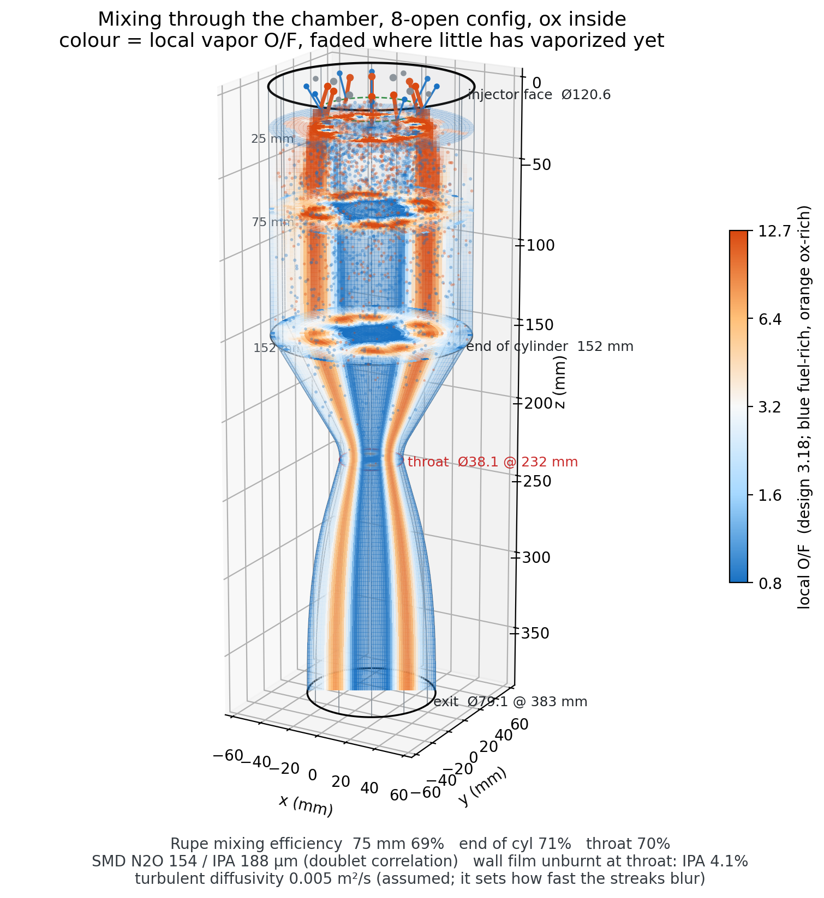
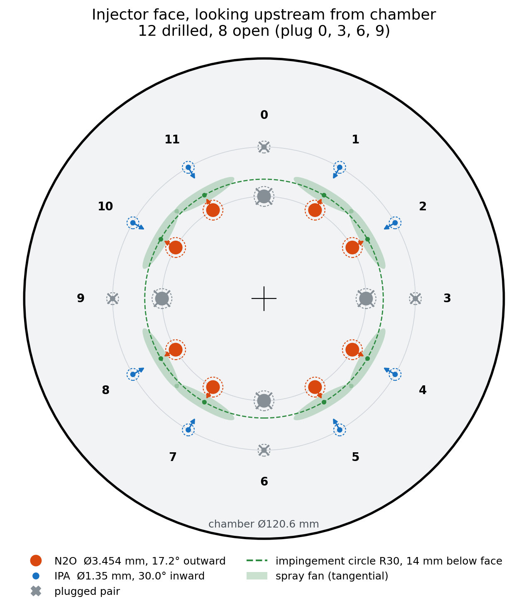
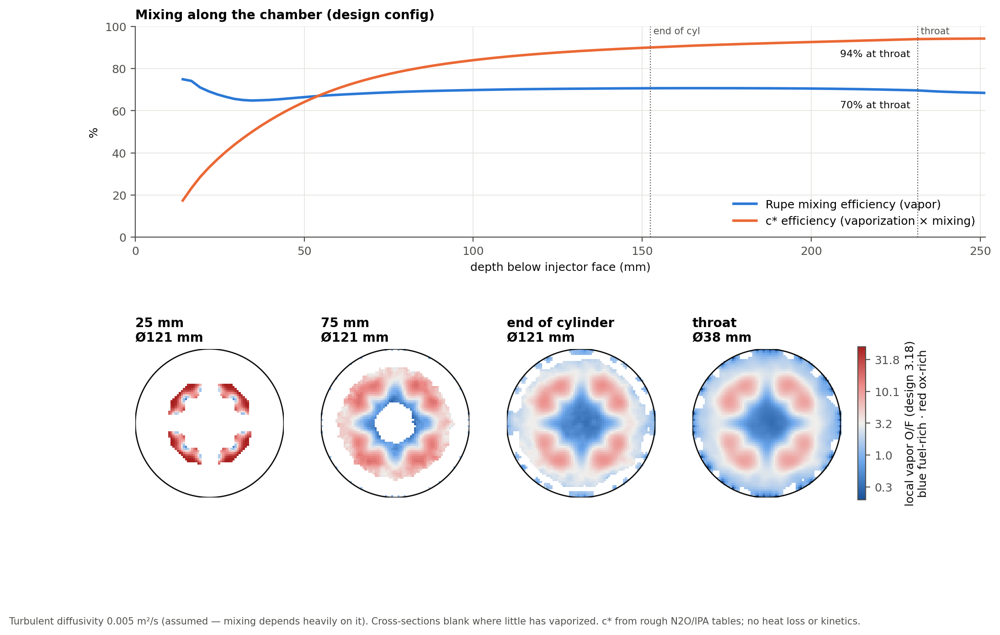

# N2O / IPA liquid motor: injector and nozzle design

[](https://github.com/mthomsn/n2o-ipa-motor/actions/workflows/checks.yml)

Design tools for a small nitrous oxide / isopropyl alcohol bipropellant rocket motor:
sizing and layout of an unlike-doublet injector, a reduced-order model of spray,
vaporization and mixing in the chamber, and 1-D isentropic sizing of cold-flow test nozzles.

The motor is a Comet Rocketry (UT Dallas) team project. The
code in this repo is my contribution to the injector and nozzle design.

<p align="center">
  
  
</p>

## What's here

| Folder | What it does |
| --- | --- |
| [`injector/`](injector/) | Splits the motor's total CdA into N doublet pairs and sizes holes, jet angles and momentum ratio. It lays out the face with over-drilled, pluggable elements and models the spray downstream: droplet size, drag, d²-law vaporization, N2O flashing, wall film and turbulent mixing. It outputs face drawings, 3D renders and mixing-efficiency estimates. |
| [`nozzle/`](nozzle/) | Scales the motor nozzle down to a ½" pipe for a converging vs converging-diverging cold-flow demo. It checks expansion against shop-air supply pressure (flow separation) and gives converging and diverging section lengths. |
| `nozzle_xyz.txt` | Bell nozzle wall contour (inches from the throat), used by both. |

Each folder's README covers the equations, assumptions and inputs in detail.

## Design point

- Propellants: N2O / IPA, O/F ≈ 3.2
- Chamber Ø120.6 mm, throat Ø38.1 mm, expansion ratio ≈ 4.3
- Injector: one ring of radial unlike doublets on a 30 mm impingement circle, 12 drilled
  and 8 open at design, with the ox jet tilted 17.2° so the combined spray points down the axis
- Inputs come from HalfCatSim (Half Cat Rocketry), with cell references noted in each script

## Selected results



At the design configuration the model predicts about 95% of the IPA vaporized by the
throat, a Rupe mixing efficiency of about 70%, and about 4% of the IPA lost as unburnt wall film.
[`sensitivity.png`](injector/output/plots/sensitivity.png) shows how strongly these depend on
assumed drop size and turbulent diffusivity. The model is for comparing layouts, not for
absolute performance.

## Running

```bash
pip install -r requirements.txt
cd injector && python chamber_mixing.py
```

```bash
python nozzle/nozzle.py --contour nozzle_xyz.txt
```

```bash
python -m unittest discover tests
```

## Status and next steps

- [ ] Cold-flow test to measure discharge coefficients (currently assumed: 0.40 ox, 0.60 fuel)
- [ ] Replace the rough combustion gas table with NASA CEA output
- [ ] Calibrate atomization and mixing constants against patternator / hot-fire data
- [ ] Add secondary droplet breakup to the spray model

## License

All rights reserved for now, pending the club's OK on licensing.
